# Olá, eu sou o Bruno 👋

Estagiário de **Suporte de TI na SJCDH** (Governo do RS) e estudante de **Ciência da Computação na PUCRS**. Resolvo problemas de ponta a ponta: do hardware à rede, do atendimento ao usuário ao código.

- 🛠️ **No dia a dia:** atendimento N1/N2/N3 presencial e remoto, GLPI, Active Directory, redes (TCP/IP, DNS, DHCP e Wi-Fi), Windows, Office 365 e manutenção de computadores
- 💻 **No código:** React, TypeScript, Java, Python e C/C++
- 🌐 **Portfólio:** [portifolio-mu-ecru.vercel.app](https://portifolio-mu-ecru.vercel.app/)
- 📫 **Contato:** [brunoandradeprof7@gmail.com](mailto:brunoandradeprof7@gmail.com) · [LinkedIn](https://www.linkedin.com/in/bruno-andrade-4a1581313/)

## Tecnologias

**Suporte e infraestrutura**

**Desenvolvimento**

## 🟡 Pac-Man (em construção)

Um Pac-Man que vai comer meu gráfico de contribuições, com fantasminhas atrás dele. Estou construindo aos poucos: acompanhe em [pacman/ROADMAP.md](pacman/ROADMAP.md).

---

🇺🇸 IT Support intern at the Rio Grande do Sul State Government and Computer Science student at PUCRS, Brazil. Check out my [portfolio](https://portifolio-mu-ecru.vercel.app/) (available in English).
